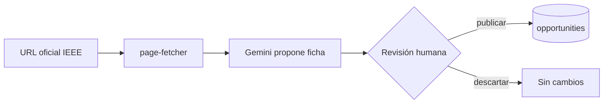

# Obsidian Flavored Markdown (referencia rápida)

## Enlaces e incrustaciones

| Sintaxis | Efecto |
|---|---|
| `[[Nota]]` | Enlace wiki (resuelve por nombre de archivo o alias) |
| `[[Nota\|texto]]` | Texto visible distinto (en tablas, escapar `\|`) |
| `[[Nota#Encabezado]]` | Enlace a encabezado |
| `[[Nota#^id]]` | Enlace a bloque; el bloque termina con ` ^id` |
| `![[Nota]]` / `![[Nota#Encabezado]]` | Incrustar nota o sección |
| `![[imagen.png\|300]]` | Imagen con ancho |
| `[texto](https://…)` | Enlace externo |

Los enlaces de dentro de bloques de código no cuentan como enlaces.

## Callouts (desde v0.14)

```markdown
> [!tipo] Título opcional
> Contenido
> [!tipo]- Plegado por defecto   |   > [!tipo]+ Desplegado plegable
```

Tipos nativos: `note`, `abstract` (`summary`, `tldr`), `info`, `todo`, `tip`
(`hint`, `important`), `success` (`check`, `done`), `question` (`help`, `faq`),
`warning` (`caution`, `attention`), `failure` (`fail`, `missing`), `danger`
(`error`), `bug`, `example`, `quote` (`cite`). Se pueden anidar con `>>`.

## Otros elementos

- **Properties:** YAML entre `---` al inicio (texto, lista, número, checkbox, fecha,
  fecha-hora). `tags`, `aliases` y `cssclasses` son especiales.
- **Etiquetas:** `#modulo-1`, anidadas `#tipo/decision`. Sin espacios; no pueden
  ser solo números.
- **Comentarios:** `%% oculto en lectura %%`.
- **Resaltado:** `==texto==` (v1.14 permite varios colores de resaltado).
- **Tareas:** `- [ ]` / `- [x]`.
- **Notas al pie:** `texto[^1]` y `[^1]: nota`.
- **Matemáticas:** `$inline$` y `$$bloque$$` (MathJax).
- **Mermaid:** bloque ```` ```mermaid ```` (flowchart, sequenceDiagram,
  erDiagram, stateDiagram…). Ideal para flujos del producto (alta por invitación,
  versionado de formularios) y para diagramas ER de las tablas. Los nodos Mermaid
  pueden enlazar notas con `class NodoX internal-link;`.
- **Búsqueda incrustada:** bloque ```` ```query ```` con sintaxis de búsqueda.
- **Bases incrustadas:** bloque ```` ```base ```` con el YAML de una base.

## Ejemplo: flujo en Mermaid para un subgrupo


