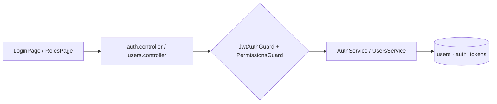

# M1 - Código del módulo

[[Cerebro 1 - Base institucional]] · documentación técnica del módulo

> [!abstract] Qué hace el código
> Autenticación propia (correo + contraseña, JWT), administración de usuarios por la Mesa Directiva y consulta de la matriz de permisos.

> [!info] Convenciones de toda la API
> - Sin prefijo global de rutas; `main.ts` aplica `helmet`, CORS y `ValidationPipe`.
> - Guard global JWT: toda ruta exige sesión salvo las marcadas con `@Public()`.
> - `@RequirePermission(función, acceso)` se compara con la matriz oficial del Módulo 1.

## Grupos técnicos

Cada grupo tiene una nota por pieza del código:

- [[M1 - API]]
- [[M1 - DTO y validaciones]]
- [[M1 - Lógica del backend]]
- [[M1 - Base de datos]]
- [[M1 - Interfaz]]
- [[M1 - Pruebas]]

## Endpoints del backend

| Método | Ruta | Acceso |
|---|---|---|
| `POST` | `/auth/login` | Público |
| `GET` | `/auth/me` | Sesión |
| `POST` | `/auth/links/inspect` | Público |
| `POST` | `/auth/links/password` | Público |
| `GET` | `/access/matrix` | Sesión |
| `GET` | `/access/chapters` | Usuarios · Total |
| `GET` | `/users` | Usuarios · Total |
| `POST` | `/users/invitations` | Usuarios · Total |
| `GET` | `/users/:id` | Usuarios · Total |
| `PATCH` | `/users/:id` | Usuarios · Total |
| `PATCH` | `/users/:id/status` | Usuarios · Total |
| `POST` | `/users/:id/access-link` | Usuarios · Total |

## Flujo

## Backend (`backendChapterCoreIEEE/src/`)

- **Controladores:** `auth/controllers/auth.controller.ts`, `auth/controllers/users.controller.ts`, `auth/controllers/access.controller.ts`
- **Servicios:** `auth/services/auth.service.ts`, `auth/services/users.service.ts`, `auth/services/access-token.service.ts`, `auth/services/password-hasher.service.ts`
- **Dominio:** `auth/domain/permissions.ts`, `auth/domain/position.ts`, `auth/domain/password-policy.ts`, `auth/domain/one-time-token.ts`, `auth/domain/authenticated-user.ts`
- **Guards y decoradores:** `auth/guards/jwt-auth.guard.ts`, `auth/guards/permissions.guard.ts`, `auth/decorators/public.decorator.ts`, `auth/decorators/require-permission.decorator.ts`, `auth/decorators/current-user.decorator.ts`
- **Datos:** `auth/entities/user.entity.ts`, `auth/entities/auth-token.entity.ts`, `auth/repositories/users.repository.ts`, `auth/repositories/auth-tokens.repository.ts`, `auth/repositories/chapters.repository.ts`, `database/migrations/1792454400000-CreateAuthModule.ts`, `database/seeds/create-admin.ts`

## Frontend (`frontendChapterCoreIEEE/src/`)

| Ruta | Página |
|---|---|
| `/login` | LoginPage |
| `/activar` | ActivateAccountPage (enlaces de un solo uso) |
| `/accesos` | RolesPage |

- `features/auth/ (LoginPage, ActivateAccountPage, AuthLayout)`
- `features/access/ (RolesPage, UsersPanel, UserDialog, PermissionMatrixCard, AccessLinkNotice)`
- `auth/ (AuthProvider, RouteGuards, auth-context)`
- `lib/session.ts, lib/access.ts`
- `api/auth.ts, types/auth.ts, hooks/useIeeeSocieties.ts`

## Pruebas

- **Backend:** `auth/domain/permissions.spec.ts`, `auth/guards/guards.spec.ts`, `auth/services/auth.service.spec.ts`, `auth/services/users.service.spec.ts`
- **Frontend:** `features/auth/auth-flow.test.tsx`

## Documentos y mockups

- `CONTEXTO.md` §5 (cargos, capítulos y decisiones del Módulo 1)
- Mockups `01-login` y `03-roles-permisos`

## Enlaces

- Cerebro del módulo: [[Cerebro 1 - Base institucional]].
- Detalle de reglas y datos: [[M1 - Modelo de datos users y auth_tokens]], [[M1 - Niveles de acceso]], [[M1 - Enlaces de un solo uso]].
