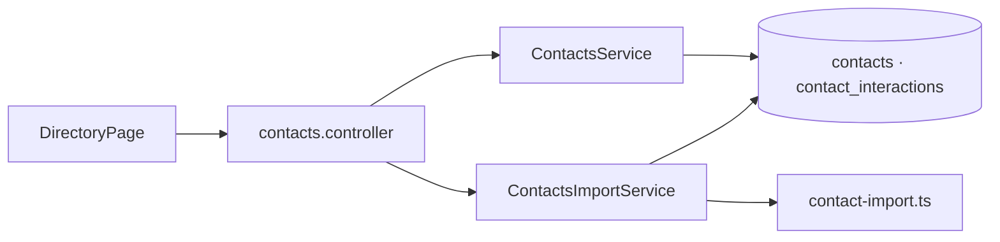

# M2 - Código del módulo

[[Cerebro 2 - Contactos]] · documentación técnica del módulo

> [!abstract] Qué hace el código
> CRUD del directorio de contactos, importación CSV y registro de interacciones.

> [!info] Convenciones de toda la API
> - Sin prefijo global de rutas; `main.ts` aplica `helmet`, CORS y `ValidationPipe`.
> - Guard global JWT: toda ruta exige sesión salvo las marcadas con `@Public()`.
> - `@RequirePermission(función, acceso)` se compara con la matriz oficial del Módulo 1.

## Grupos técnicos

Cada grupo tiene una nota por pieza del código:

- [[M2 - API]]
- [[M2 - DTO y validaciones]]
- [[M2 - Lógica del backend]]
- [[M2 - Base de datos]]
- [[M2 - Interfaz]]
- [[M2 - Pruebas]]

## Endpoints del backend

| Método | Ruta | Acceso |
|---|---|---|
| `GET` | `/contacts` | Contactos · Ver |
| `GET` | `/contacts/sectors` | Contactos · Ver |
| `GET` | `/contacts/chapters` | Contactos · Ver |
| `GET` | `/contacts/:id` | Contactos · Ver |
| `POST` | `/contacts` | Contactos · Editar |
| `POST` | `/contacts/import` | Contactos · Editar (CSV ≤ 1 MB) |
| `PUT` | `/contacts/:id` | Contactos · Editar |
| `DELETE` | `/contacts/:id` | Contactos · Total |
| `POST` | `/contacts/:id/interactions` | Contactos · Editar |

## Flujo

## Backend (`backendChapterCoreIEEE/src/`)

- **Controlador:** `contacts/controllers/contacts.controller.ts`
- **Servicios:** `contacts/services/contacts.service.ts`, `contacts/services/contacts-import.service.ts`
- **Dominio:** `contacts/domain/contact.ts`, `contacts/domain/contact-import.ts`, `contacts/domain/csv.ts`
- **DTO:** `contacts/dto/contact.dto.ts`, `contacts/dto/create-interaction.dto.ts`, `contacts/dto/list-contacts-query.dto.ts`, `contacts/dto/list-sectors-query.dto.ts`
- **Datos:** `contacts/entities/contact.entity.ts`, `contacts/entities/contact-interaction.entity.ts`, `contacts/repositories/contacts.repository.ts`, `contacts/repositories/contact-interactions.repository.ts`, `contacts/mappers/contact.mapper.ts`, `database/migrations/1792627200000-CreateContactsModule.ts`

## Frontend (`frontendChapterCoreIEEE/src/`)

| Ruta | Página |
|---|---|
| `/contactos` | DirectoryPage |

- `features/contacts/ (DirectoryPage, ContactsTable, FilterBar, ContactDetailPanel, ContactDialog, ImportCsvDialog, InteractionDialog, StatusPill, Dialog)`
- `api/contacts.ts, types/contacts.ts`

## Pruebas

- **Backend:** `contacts/domain/contact-import.spec.ts`, `contacts/services/contacts.service.spec.ts`
- **Frontend:** `features/contacts/DirectoryPage.test.tsx`

## Documentos y mockups

- `CONTEXTO.md` §5 (decisiones del Módulo 2)
- Mockup `04-contactos`

## Enlaces

- Cerebro del módulo: [[Cerebro 2 - Contactos]].
- Detalle de reglas y datos: [[M2 - Modelo de datos contacts]], [[M2 - Importación CSV]], [[M2 - Acciones por nivel de acceso]].
