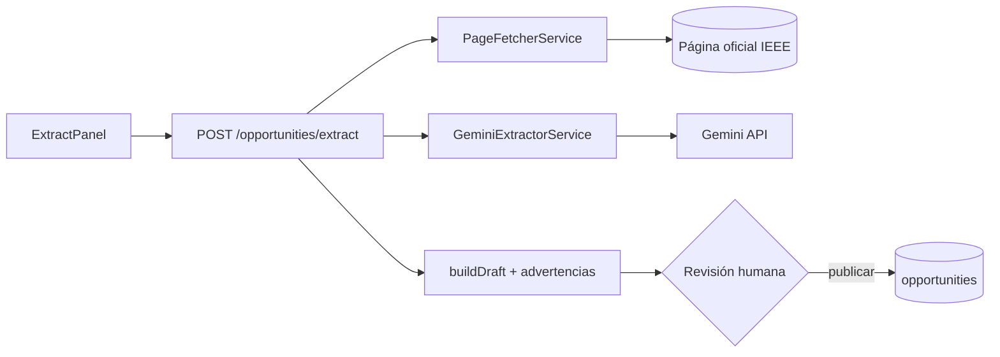

# M3 - Código del módulo

[[Cerebro 3 - Oportunidades IEEE]] · documentación técnica del módulo

> [!abstract] Qué hace el código
> Búsqueda de oportunidades, extracción asistida por Gemini desde fuentes oficiales y publicación revisada.

> [!info] Convenciones de toda la API
> - Sin prefijo global de rutas; `main.ts` aplica `helmet`, CORS y `ValidationPipe`.
> - Guard global JWT: toda ruta exige sesión salvo las marcadas con `@Public()`.
> - `@RequirePermission(función, acceso)` se compara con la matriz oficial del Módulo 1.

## Grupos técnicos

Cada grupo tiene una nota por pieza del código:

- [[M3 - API]]
- [[M3 - DTO y validaciones]]
- [[M3 - Lógica del backend]]
- [[M3 - Base de datos]]
- [[M3 - Interfaz]]
- [[M3 - Pruebas]]

## Endpoints del backend

| Método | Ruta | Acceso |
|---|---|---|
| `GET` | `/opportunities` | Oportunidades · Ver (búsqueda) |
| `GET` | `/opportunities/societies` | Oportunidades · Ver |
| `POST` | `/opportunities/extract` | Oportunidades · Editar · 5/min |
| `POST` | `/opportunities` | Oportunidades · Editar · 10/min (publicar) |

> [!tip] Límite de peticiones
> El módulo configura 30 peticiones por minuto por defecto; extraer y publicar tienen límites propios más estrictos.

## Flujo

## Backend (`backendChapterCoreIEEE/src/`)

- **Controlador:** `opportunities/opportunities.controller.ts`
- **Servicios:** `opportunities/opportunities.service.ts`, `opportunities/gemini-extractor.service.ts`, `opportunities/page-fetcher.service.ts`
- **Reglas:** `opportunities/official-sources.ts`, `opportunities/is-official-ieee-url.decorator.ts`, `opportunities/opportunity.views.ts`
- **DTO:** `opportunities/dto/search-opportunities-query.dto.ts`, `opportunities/dto/extract-opportunity.dto.ts`, `opportunities/dto/create-opportunity.dto.ts`
- **Datos:** `opportunities/entities/opportunity.entity.ts`, `opportunities/entities/ieee-society.entity.ts`, `database/migrations/1792368000000-CreateOpportunities.ts`, `database/migrations/1792454400000-UniqueOpportunityEnlace.ts`

## Frontend (`frontendChapterCoreIEEE/src/`)

| Ruta | Página |
|---|---|
| `/oportunidades` | OpportunitiesPage |

- `features/opportunities/ (OpportunitiesPage, SearchPanel, OpportunityResults, ExtractPanel, DraftEditor)`
- `components/OpportunityCard.tsx, components/DeadlineBadge.tsx`
- `hooks/useOpportunitySearch.ts, useOpportunityExtraction.ts, useSavedOpportunities.ts`
- `lib/officialSources.ts, api/opportunities.ts, types/opportunity.ts`

## Pruebas

- **Backend:** `opportunities/opportunities.controller.spec.ts`, `opportunities/opportunities.service.spec.ts`, `opportunities/gemini-extractor.service.spec.ts`, `opportunities/page-fetcher.service.spec.ts`, `opportunities/official-sources.spec.ts`
- **Frontend:** `features/opportunities/ExtractPanel.test.tsx`, `features/opportunities/validateDraft.test.ts`

## Documentos y mockups

- `CONTEXTO.md` §7 (IA y oportunidades)
- `docs/qa/estrategia-pruebas-oportunidades.md`
- Mockup `05-oportunidades-ia`

## Enlaces

- Cerebro del módulo: [[Cerebro 3 - Oportunidades IEEE]].
- Detalle de reglas y datos: [[M3 - Modelo de datos opportunities]], [[M3 - Extracción con Gemini]], [[M3 - Fuentes oficiales admitidas]].
