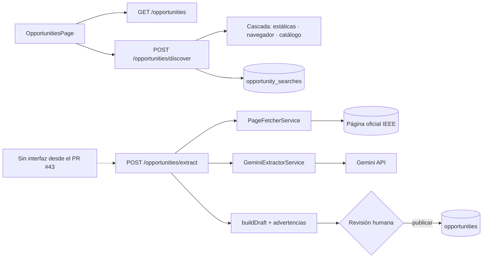

# M3 - Código del módulo

[[Cerebro 3 - Oportunidades IEEE]] · documentación técnica del módulo

> [!abstract] Qué hace el código
> Búsqueda de oportunidades, búsqueda a petición en fuentes oficiales con historial, y extracción asistida por Gemini con publicación revisada. Desde el PR #43 la interfaz solo usa la búsqueda: extraer y publicar quedan en el backend, sin pantalla.

> [!info] Convenciones de toda la API
> - Sin prefijo global de rutas; `main.ts` aplica `helmet`, CORS y `ValidationPipe`.
> - Guard global JWT: toda ruta exige sesión salvo las marcadas con `@Public()`.
> - `@RequirePermission(función, acceso)` se compara con la matriz oficial del Módulo 1.

## Grupos técnicos

Cada grupo tiene una nota por pieza del código:

- [[M3 - API]]
- [[M3 - DTO y validaciones]]
- [[M3 - Lógica del backend]]
- [[M3 - Base de datos]]
- [[M3 - Interfaz]]
- [[M3 - Pruebas]]

## Endpoints del backend

| Método | Ruta | Acceso |
|---|---|---|
| `GET` | `/opportunities` | Oportunidades · Ver (búsqueda) |
| `GET` | `/opportunities/societies` | Oportunidades · Ver |
| `POST` | `/opportunities/extract` | Oportunidades · Editar · 5/min |
| `POST` | `/opportunities` | Oportunidades · Editar · 10/min (publicar) |
| `GET` | `/opportunities/official-domains` | Oportunidades · Ver |
| `GET` | `/opportunities/discover/config` | Oportunidades · Ver |
| `POST` | `/opportunities/discover` | Oportunidades · Ver · 3/min por persona |
| `GET` | `/opportunities/search-history` | Oportunidades · Ver (solo las propias) |
| `DELETE` | `/opportunities/search-history/:id` | Oportunidades · Ver (solo las propias) |
| `DELETE` | `/opportunities/search-history` | Oportunidades · Ver (solo las propias) |

> [!tip] Límite de peticiones
> El módulo configura 30 peticiones por minuto por defecto; extraer y publicar tienen límites propios más estrictos.

## Flujo

## Backend (`backendChapterCoreIEEE/src/`)

- **Controlador:** `opportunities/opportunities.controller.ts`
- **Servicios:** `opportunities/opportunities.service.ts`, `opportunities/gemini-extractor.service.ts`, `opportunities/page-fetcher.service.ts`
- **Reglas:** `opportunities/official-sources.ts`, `opportunities/is-official-ieee-url.decorator.ts`, `opportunities/opportunity.views.ts`
- **DTO:** `opportunities/dto/search-opportunities-query.dto.ts`, `opportunities/dto/extract-opportunity.dto.ts`, `opportunities/dto/create-opportunity.dto.ts`
- **Datos:** `opportunities/entities/opportunity.entity.ts`, `opportunities/entities/ieee-society.entity.ts`, `database/migrations/1792368000000-CreateOpportunities.ts`, `database/migrations/1792454400000-UniqueOpportunityEnlace.ts`
- **Búsqueda en fuentes oficiales (spec 002):** `opportunities/discovery/` (`discovery.controller.ts`, `discovery.service.ts`, `search-history.service.ts`, `result-filter.ts`, `robots.ts`, `user-throttler.guard.ts`, `strategies/` estáticas · navegador · catálogo, `catalog/`), `opportunities/official-domains.ts`, migración `1792972800000-CreateOpportunitySearchHistory.ts`

## Frontend (`frontendChapterCoreIEEE/src/`)

| Ruta | Página |
|---|---|
| `/oportunidades` | OpportunitiesPage |

- `features/opportunities/ (OpportunitiesPage, SearchPanel, OpportunityResults, OfficialSearchResults, DiscoveryResultList, StrategySelector, SearchHistory, filters, discoveryAnnouncement)`
- `components/OpportunityCard.tsx, components/DeadlineBadge.tsx`
- `hooks/useOpportunitySearch.ts, useSavedOpportunities.ts, useOpportunityDiscovery.ts, useSearchHistory.ts`
- `api/opportunities.ts, types/opportunity.ts`
- Retirados en el PR #43: `ExtractPanel`, `ExtractSteps`, `DraftCard`, `DraftEditor`, `validateDraft`, `useOpportunityExtraction`, `useOfficialDomains`, `lib/officialSources.ts`.

## Pruebas

- **Backend:** `opportunities/opportunities.controller.spec.ts`, `opportunities/opportunities.service.spec.ts`, `opportunities/gemini-extractor.service.spec.ts`, `opportunities/page-fetcher.service.spec.ts`, `opportunities/official-sources.spec.ts` y las de `opportunities/discovery/` (cascada, estrategias, catálogo, filtro, robots e historial)
- **Frontend:** `features/opportunities/OpportunitiesPage.test.tsx`, `OfficialSearchResults.test.tsx`, `filters.test.ts`, `hooks/useOpportunityDiscovery.test.ts`
- **E2E:** `backendChapterCoreIEEE/test/e2e/opportunities-discovery.e2e.mjs` (comprueba que no aparecen el panel ni «Extraer ficha»)

## Documentos y mockups

- `CONTEXTO.md` §7 (IA y oportunidades) · `specs/002-oportunidades-fuentes-oficiales/`
- `docs/qa/estrategia-pruebas-oportunidades.md`
- Mockup `05-oportunidades-ia`

## Enlaces

- Cerebro del módulo: [[Cerebro 3 - Oportunidades IEEE]].
- Detalle de reglas y datos: [[M3 - Modelo de datos opportunities]], [[M3 - Extracción con Gemini]], [[M3 - Fuentes oficiales admitidas]], [[M3 - Búsqueda en fuentes oficiales]], [[M3 - Historial de búsquedas]].
