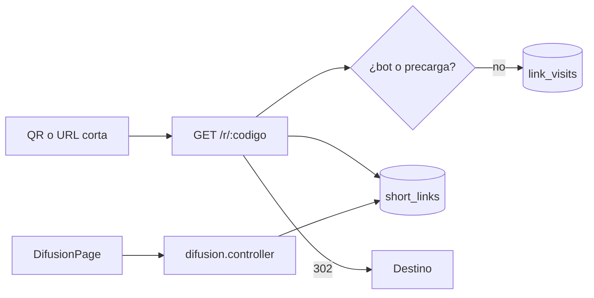

# M4 - Código del módulo

[[Cerebro 4 - Difusión y QR]] · documentación técnica del módulo

> [!abstract] Qué hace el código
> Administración de enlaces cortos y QR dinámicos, estadísticas de visitas y redirección pública.

> [!info] Convenciones de toda la API
> - Sin prefijo global de rutas; `main.ts` aplica `helmet`, CORS y `ValidationPipe`.
> - Guard global JWT: toda ruta exige sesión salvo las marcadas con `@Public()`.
> - `@RequirePermission(función, acceso)` se compara con la matriz oficial del Módulo 1.

## Grupos técnicos

Cada grupo tiene una nota por pieza del código:

- [[M4 - API]]
- [[M4 - DTO y validaciones]]
- [[M4 - Lógica del backend]]
- [[M4 - Base de datos]]
- [[M4 - Interfaz]]
- [[M4 - Pruebas]]

## Endpoints del backend

| Método | Ruta | Acceso |
|---|---|---|
| `GET` | `/difusion/enlaces` | Difusión · Ver |
| `POST` | `/difusion/enlaces` | Difusión · Editar · 20/min |
| `PATCH` | `/difusion/enlaces/:id` | Difusión · Editar |
| `GET` | `/difusion/enlaces/:id/estadisticas` | Difusión · Ver |
| `GET` | `/r/:codigo` | Público · 120/min (redirección) |

> [!tip] Límite de peticiones
> El módulo configura 60 peticiones por minuto por defecto; crear enlaces y la redirección pública tienen límites propios.

## Flujo

## Backend (`backendChapterCoreIEEE/src/`)

- **Controladores:** `difusion/difusion.controller.ts`, `difusion/redirect.controller.ts`
- **Servicio y reglas:** `difusion/difusion.service.ts`, `difusion/short-links.util.ts`, `difusion/short-link.views.ts`
- **DTO:** `difusion/dto/short-link.dto.ts`
- **Datos:** `difusion/entities/short-link.entity.ts`, `difusion/entities/link-visit.entity.ts`, `database/migrations/1792540800000-CreateDifusionModule.ts`

## Frontend (`frontendChapterCoreIEEE/src/`)

| Ruta | Página |
|---|---|
| `/difusion` | DifusionPage |

- `features/difusion/ (DifusionPage, LinksTable, NewLinkPanel, EditLinkForm, QrPreviewPanel, ScanStatsPanel)`
- `hooks/useShortLinks.ts, useLinkStats.ts, useQrSvg.ts`
- `lib/qr.ts (QR generado en el navegador), api/difusion.ts, types/difusion.ts`

## Pruebas

- **Backend:** `difusion/difusion.controller.spec.ts`, `difusion/difusion.service.spec.ts`, `difusion/short-links.util.spec.ts`
- **Frontend:** `features/difusion/DifusionPage.test.tsx`, `features/difusion/validateLink.test.ts`

## Documentos y mockups

- `docs/modulo-4-difusion-qr.md` (único documento técnico de módulo en el repositorio)
- Mockup `06-difusion-qr`

## Enlaces

- Cerebro del módulo: [[Cerebro 4 - Difusión y QR]].
- Detalle de reglas y datos: [[M4 - Modelo short_links y link_visits]], [[M4 - Redirección pública]], [[M4 - Validación de destinos]].
