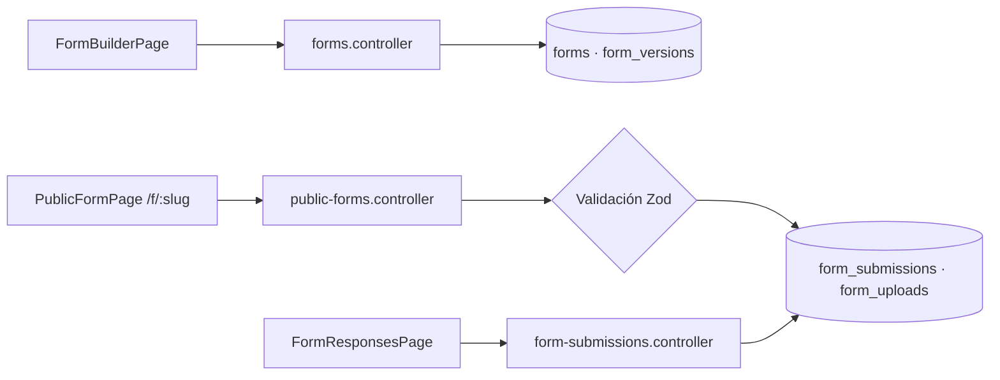

# M5 - Código del módulo

[[Cerebro 5 - Secretaría y formularios]] · documentación técnica del módulo

> [!abstract] Qué hace el código
> Constructor de formularios versionados, formularios públicos sin sesión, revisión de respuestas, estadísticas, adjuntos y exportación XLSX.

> [!info] Convenciones de toda la API
> - Sin prefijo global de rutas; `main.ts` aplica `helmet`, CORS y `ValidationPipe`.
> - Guard global JWT: toda ruta exige sesión salvo las marcadas con `@Public()`.
> - `@RequirePermission(función, acceso)` se compara con la matriz oficial del Módulo 1.

## Grupos técnicos

Cada grupo tiene una nota por pieza del código:

- [[M5 - API]]
- [[M5 - DTO y validaciones]]
- [[M5 - Lógica del backend]]
- [[M5 - Base de datos]]
- [[M5 - Interfaz]]
- [[M5 - Pruebas]]

## Endpoints del backend

| Método | Ruta | Acceso |
|---|---|---|
| `POST` | `/forms` | Formularios · Editar |
| `GET` | `/forms` | Formularios · Editar |
| `GET` | `/forms/:id` | Formularios · Editar |
| `PATCH` | `/forms/:id` | Formularios · Editar |
| `POST` | `/forms/:id/publish` | Formularios · Editar |
| `DELETE` | `/forms/:id` | Formularios · Total |
| `GET` | `/forms/:formId/submissions` | Formularios · Editar |
| `GET` | `/forms/:formId/submissions/stats` | Formularios · Editar |
| `GET` | `/forms/:formId/submissions/export` | Formularios · Editar (XLSX) |
| `GET` | `/forms/:formId/submissions/:id` | Formularios · Editar |
| `GET` | `/forms/:formId/submissions/:id/uploads/:uploadId` | Formularios · Editar |
| `PATCH` | `/forms/:formId/submissions/:id/review` | Formularios · Editar |
| `GET` | `/public/forms/:slug` | Público |
| `POST` | `/public/forms/:slug/submissions` | Público |

## Flujo

## Backend (`backendChapterCoreIEEE/src/`)

- **Controladores:** `forms/forms.controller.ts`, `forms/form-submissions.controller.ts`, `forms/public-forms.controller.ts`
- **Servicios:** `forms/forms.service.ts`, `forms/form-submissions.service.ts (exportación con exceljs)`
- **Esquema:** `forms/schema/form-schema.types.ts`, `forms/schema/form-schema.zod.ts`, `forms/form-response.types.ts`
- **Almacenamiento:** `forms/storage/storage.service.ts`, `forms/storage/local-storage.service.ts`, `forms/storage/storage.module.ts`
- **Datos:** `forms/entities/form.entity.ts`, `forms/entities/form-version.entity.ts`, `forms/entities/form-submission.entity.ts`, `forms/entities/form-upload.entity.ts`, `database/migrations/1730000000000-CreateFormsModule.ts`

## Frontend (`frontendChapterCoreIEEE/src/`)

| Ruta | Página |
|---|---|
| `/secretaria/formularios` | FormsListPage |
| `/secretaria/formularios/nuevo` | FormBuilderPage |
| `/secretaria/formularios/:id/editar` | FormBuilderPage |
| `/secretaria/formularios/:id/respuestas` | FormResponsesPage |
| `/f/:slug` | PublicFormPage (sin sesión) |

- `features/forms/ (FormsListPage, FormBuilderPage, BuilderCanvas, FieldPalette, FieldEditor, SchemaPreview)`
- `features/responses/ (FormResponsesPage, StatsPanel, SubmissionDetail)`
- `features/public/ (PublicFormPage, DynamicForm)`
- `lib/form-schema.ts, lib/form-schema-helpers.ts, types/forms.ts, hooks/usePublishedForms.ts`

## Pruebas

- **Backend:** `forms/form-submissions.service.spec.ts`, `forms/schema/form-schema.zod.spec.ts`
- **Frontend:** `features/public/DynamicForm.test.tsx`, `features/responses/StatsPanel.test.tsx`, `lib/form-schema.test.ts`

## Documentos y mockups

- `CONTEXTO.md` §4 (alcance) y §9 (pendientes de formularios)
- Mockups `07-formularios` y `08-formulario-movil`

## Enlaces

- Cerebro del módulo: [[Cerebro 5 - Secretaría y formularios]].
- Detalle de reglas y datos: [[M5 - Versionado de formularios]], [[M5 - Tipos de campo]], [[M5 - Estados de una respuesta]].
