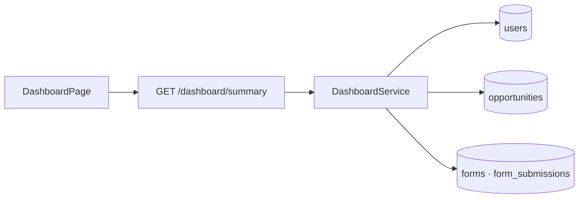

# M6 - Código del módulo

[[Cerebro 6 - Feedback y KPIs]] · documentación técnica del módulo

> [!abstract] Qué hace el código
> Un único endpoint que agrega datos de los módulos 1, 3 y 5 en el resumen del Dashboard.

> [!info] Convenciones de toda la API
> - Sin prefijo global de rutas; `main.ts` aplica `helmet`, CORS y `ValidationPipe`.
> - Guard global JWT: toda ruta exige sesión salvo las marcadas con `@Public()`.
> - `@RequirePermission(función, acceso)` se compara con la matriz oficial del Módulo 1.

## Grupos técnicos

Cada grupo tiene una nota por pieza del código:

- [[M6 - API]]
- [[M6 - DTO y validaciones]]
- [[M6 - Lógica del backend]]
- [[M6 - Interfaz]]
- [[M6 - Pruebas]]

## Endpoints del backend

| Método | Ruta | Acceso |
|---|---|---|
| `GET` | `/dashboard/summary?period=month|semester|management` | Dashboard · Ver |

> [!warning] Sin tablas propias
> El Módulo 6 no tiene migración ni tablas: calcula todo en cada petición a partir de los datos de otros módulos.

## Flujo

## Backend (`backendChapterCoreIEEE/src/`)

- **Controlador:** `dashboard/dashboard.controller.ts`
- **Servicio:** `dashboard/dashboard.service.ts (lee users, opportunities, forms y form_submissions)`
- **Tipos y DTO:** `dashboard/dashboard.types.ts`, `dashboard/dto/dashboard-query.dto.ts`

## Frontend (`frontendChapterCoreIEEE/src/`)

| Ruta | Página |
|---|---|
| `/dashboard` | DashboardPage |

- `features/dashboard/DashboardPage.tsx`
- `hooks/useDashboardSummary.ts, api/dashboard.ts, types/dashboard.ts`

## Pruebas

- **Backend:** `dashboard/dashboard.service.spec.ts`
- **Frontend:** `features/dashboard/DashboardPage.test.tsx`

## Documentos y mockups

- `CONTEXTO.md` §4 (fórmulas KPI aprobadas)
- Mockup `02-dashboard`

## Enlaces

- Cerebro del módulo: [[Cerebro 6 - Feedback y KPIs]].
- Detalle de reglas y datos: [[M6 - Cálculo del NPS]], [[M6 - Satisfacción promedio]], [[M6 - Limitaciones del dashboard]].
