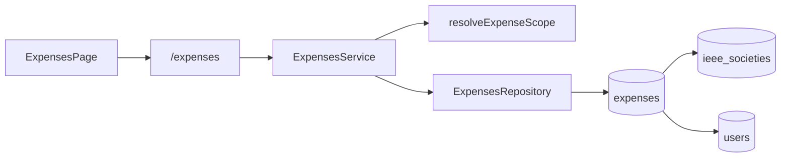

# M7 - Código del módulo

[[Cerebro 7 - Tesorería y Gastos]] · documentación técnica del módulo

> [!abstract] Qué hace el código
> Un módulo NestJS `expenses/` con cuatro endpoints (listar, resumir, registrar y eliminar
> gastos), una tabla `expenses` y la pantalla `/tesoreria`. Llegó a `main` con el PR #31
> (`607d4b8`), que integró el PR #30 de la rama `feat/modulo-7-gastos-tesoreria`.

> [!info] Convenciones de toda la API
> - Sin prefijo global de rutas; `main.ts` aplica `helmet`, CORS y `ValidationPipe`.
> - Guard global JWT: toda ruta exige sesión salvo las marcadas con `@Public()`.
> - `@RequirePermission(función, acceso)` se compara con la matriz oficial del Módulo 1.

## Grupos técnicos

Cada grupo tiene una nota por pieza del código:

- [[M7 - API]]
- [[M7 - DTO y validaciones]]
- [[M7 - Lógica del backend]]
- [[M7 - Base de datos]]
- [[M7 - Interfaz]]
- [[M7 - Pruebas]]

## Endpoints del backend

| Método | Ruta | Acceso |
|---|---|---|
| `GET` | `/expenses?desde&hasta&categoria&alcance&page&limit` | Gastos · Ver |
| `GET` | `/expenses/summary?desde&hasta&alcance` | Gastos · Ver |
| `POST` | `/expenses` | Gastos · Editar |
| `DELETE` | `/expenses/:id` | Gastos · Total |

## Flujo

## Backend (`backendChapterCoreIEEE/src/`)

- **Controlador:** `expenses/controllers/expenses.controller.ts`
- **Servicio y dominio:** `expenses/services/expenses.service.ts`, `expenses/domain/expense.ts`
- **Datos:** `expenses/entities/expense.entity.ts`, `expenses/repositories/expenses.repository.ts`, `expenses/mappers/expense.mapper.ts`
- **DTO:** `expenses/dto/expense-input.dto.ts`, `list-expenses-query.dto.ts`, `expense-summary-query.dto.ts`
- **Migración:** `database/migrations/1792886400000-CreateExpensesModule.ts`
- **Permisos:** fila `Feature.Expenses` en `auth/domain/permissions.ts`

## Frontend (`frontendChapterCoreIEEE/src/`)

| Ruta | Página |
|---|---|
| `/tesoreria` | ExpensesPage (entrada **Tesorería** del menú) |

- `features/expenses/` (ExpensesPage, ExpenseDialog, ExpensesTable, expense-schema, expense-labels, useExpenses)
- `api/expenses.ts`, `types/expenses.ts`, `lib/format.ts` (`formatMoney`, `CURRENCY`)

## Pruebas

- **Backend:** `expenses/domain/expense.spec.ts`, `expenses/dto/expense-input.dto.spec.ts`, `expenses/services/expenses.service.spec.ts`
- **Frontend:** `features/expenses/ExpensesPage.test.tsx`, `features/expenses/expense-schema.test.ts`

## Documentos y mockups

- `specs/009-modulo-7-gastos-tesoreria/` (spec, plan, data-model, contratos, quickstart y tareas)
- `docs/spec-modulo-7-gastos.md`, `CONTEXTO.md` §4 y §9
- Sin mockup propio.

## Enlaces

- Cerebro del módulo: [[Cerebro 7 - Tesorería y Gastos]].
- Detalle de reglas y datos: [[M7 - Modelo de datos expenses]], [[M7 - Alcance por capítulo de gastos]], [[M7 - Total gastado por periodo]].
