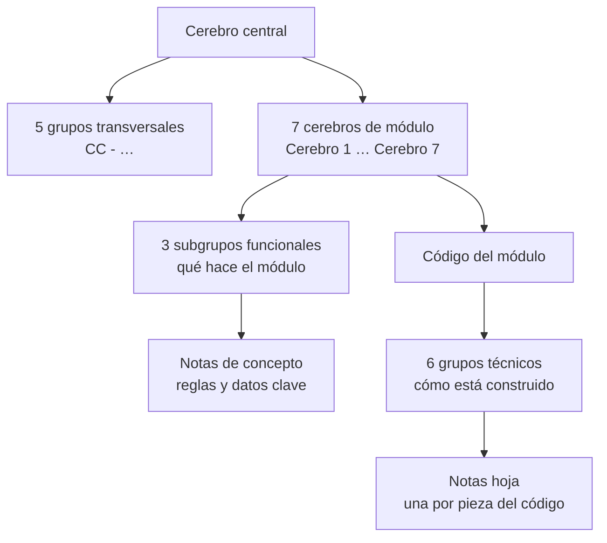

# ChapterCore IEEE — Bóveda de Obsidian

Bóveda de conocimiento del proyecto académico **ChapterCore**, el sistema de gestión de la
Rama Estudiantil IEEE (UPB) y sus capítulos. Explica **qué hace el sistema y cómo está
construido**, módulo por módulo, con cada afirmación respaldada por el código del producto.

- Repositorio del producto: [marianZamorano/chapterCoreIEEE](https://github.com/marianZamorano/chapterCoreIEEE)
- Equipo: Valeria Isabel Lopez Pinto · Marian Isabel Zamorano Alcazar · Angela de Jesus Valcarce Arumbary

## Cómo abrir la bóveda

1. Clona este repositorio.
2. En Obsidian: **Abrir carpeta como bóveda** → selecciona la carpeta clonada.
3. Empieza por [ChapterCore - Cerebro central](Cerebros/ChapterCore%20-%20Cerebro%20central.md)
   o abre el grafo (**Ctrl+G**).

## Qué es un "cerebro"

Un **cerebro** es un mapa de conocimiento: una nota principal que resume un área y enlaza
todas las notas que la detallan. En el grafo de Obsidian cada cerebro se ve como un
**racimo de nodos del mismo color**.

La bóveda tiene **un cerebro central** y **siete cerebros especializados**, uno por cada
módulo de ChapterCore.

## Estructura



Cada nivel enlaza solo hacia su padre y sus hijos. Las relaciones entre módulos se expresan
**entre cerebros**, nunca entre notas de detalle. Por eso cada módulo forma un racimo propio.

### Cerebro central (dorado)

Resume el producto y conecta los siete cerebros. Además tiene su propio conocimiento,
lo que no pertenece a un solo módulo:

| Grupo | Qué contiene |
|---|---|
| **CC - Arquitectura y stack** | Backend NestJS, frontend React, PostgreSQL y migraciones, dependencias, variables de entorno (solo nombres), scripts |
| **CC - Seguridad transversal** | Autenticación JWT, matriz de permisos, cabeceras y validación HTTP, límites de peticiones, rutas protegidas, secretos |
| **CC - Despliegue e integración continua** | GitHub Actions, producción en Neon y Vercel, entorno local con Docker |
| **CC - Diseño e interfaz** | Paleta IEEE, navegación, componentes compartidos y una nota por cada uno de los 8 mockups |
| **CC - Proyecto y equipo** | Equipo, alcance del MVP, fuentes de verdad, decisiones confirmadas, pendientes y reglas para agentes |

### Los siete cerebros de módulo

| Módulo | Color | Cerebro | De qué se ocupa |
|---|---|---|---|
| 1 | Naranja | Base institucional | Cuentas, cargos, niveles de acceso, permisos y catálogo de capítulos |
| 2 | Coral | Contactos | Directorio de empresas, alumni, conferencistas y autoridades, con su historial |
| 3 | Amarillo | Oportunidades IEEE | Becas, concursos y voluntariados con extracción asistida por IA (Gemini) y búsqueda a petición en fuentes oficiales |
| 4 | Verde | Difusión y QR | Enlaces cortos, QR dinámicos y conteo de visitas |
| 5 | Azul | Secretaría y formularios | Formularios dinámicos versionados, respuestas y adjuntos |
| 6 | Violeta | Feedback y KPIs | Dashboard: miembros, oportunidades, respuestas, satisfacción, NPS y escaneos QR |
| 7 | Turquesa | Tesorería y gastos | Gastos de la Rama y de cada capítulo y total gastado por periodo |

### Dentro de cada cerebro

Cada cerebro tiene dos lados:

- **Lado funcional (qué hace):** 3 subgrupos temáticos, por ejemplo *Directorio*,
  *Relaciones institucionales* y *Seguimiento* en Contactos. Debajo de cada uno van **notas
  de concepto** que explican una regla o dato concreto, como *M2 - Importación CSV*. Están
  redactadas y revisadas a mano.
- **Lado técnico (cómo está hecho):** la nota *MN - Código del módulo* resume endpoints,
  archivos, pantallas y pruebas, y abre **6 grupos técnicos** con una nota por pieza real
  del código:

| Grupo técnico | Una nota por… | Ejemplo |
|---|---|---|
| API | endpoint (método, ruta, permiso, límites, quién lo usa) | `M3 - POST opportunities › extract` |
| DTO y validaciones | contrato de entrada y sus reglas | `M2 - DTO ContactInputDto` |
| Lógica del backend | servicio, regla de dominio, guard o repositorio | `M1 - users.service` |
| Base de datos | tabla (columnas, enums, restricciones, índices) | `M4 - Tabla short_links` |
| Interfaz | página, componente, hook, cliente de API o tipos | `M5 - FormBuilderPage` |
| Pruebas | archivo de pruebas con cada caso | `M2 - Prueba contact-import.spec` |

## Convenciones

- **Nombres:** `MN - …` para notas del módulo N, `CC - …` para las del cerebro central.
- **Properties:** `type` (tipo de nota), `modulo`, `estado` (confirmado, propuesto o
  pendiente), `fuentes` (rutas del código que la respaldan) y `actualizado`.
- **Etiquetas:** `#modulo-1` … `#modulo-6` y `#cerebro-central` dan el color en el grafo.
- **Notas generadas:** las que tienen `generado: true` (las de los grupos técnicos) se crean
  automáticamente desde el código. **No se editan a mano**: se regeneran cuando cambia el
  repositorio. El conocimiento interpretado va en cerebros, subgrupos, conceptos y notas `CC`.
- **Callouts:** propósito (`abstract`), datos (`info`), flujo (`success`), límites (`warning`)
  y pendientes (`todo` / `question`).

## Cómo navegar

- **Grafo** (Ctrl+G): muestra solo la carpeta `Cerebros/` (filtro `path:"Cerebros/"`). El
  centro dorado es el cerebro central; cada color es un módulo. Si no ves colores: ajustes
  del grafo → **Grupos**.
- **Canvas** [ChapterCore - Cerebros.canvas](ChapterCore%20-%20Cerebros.canvas): la estructura
  en un plano, con el cerebro central, cada módulo, sus subgrupos y sus grupos técnicos.
- **Backlinks**: desde cualquier nota de detalle se llega a su grupo y a su cerebro.

## Carpetas

| Carpeta | Contenido |
|---|---|
| `Cerebros/` | Todas las notas de conocimiento |
| `Auditoria/` | Registro de cada cambio hecho por agentes (ver [Auditoria/README.md](Auditoria/README.md)) |
| `.obsidian/` | Configuración compartida: plugins core, colores y filtro del grafo |
| `.claude/`, `.agents/`, `.codex/`, `.gemini/`, `.github/`, `.vscode/` | Skill y configuración de agentes de IA (Obsidian las ignora) |

## Qué se versiona

- Las notas, el canvas, la auditoría y la configuración compartida de `.obsidian/`.
- No se versiona el estado local de cada persona (paneles abiertos, caché, papelera),
  configuraciones personales de agentes ni registros locales. Ver `.gitignore`.

---

## Skill para agentes de IA: obsidian-cerebros

La skill [`.claude/skills/obsidian-cerebros/`](.claude/skills/obsidian-cerebros/SKILL.md)
convierte a un agente de IA en un experto en Obsidian que **audita, mejora y mantiene los
cerebros** contrastándolos con el código del producto. Es gratuita, local y segura:

- No inventa: toda afirmación cita su fuente en el código o en `CONTEXTO.md`.
- No lee secretos (`.env`, claves), no usa la red y no hace commits sin autorización.
- Trata lo que lee como datos, no como instrucciones (protección contra inyección de prompts).
- **Cada ejecución que cambia archivos deja un registro en `Auditoria/`.**

| Agente | Cómo encuentra la skill | MCP `chaptercore-vault` |
|---|---|---|
| Claude Code | `.claude/skills/` | `.mcp.json` |
| Codex CLI | `.agents/skills/` + `AGENTS.md` | `.codex/config.toml` |
| OpenCode | `.claude/skills/` + `AGENTS.md` | `opencode.json` |
| Gemini CLI | `GEMINI.md` → `AGENTS.md` | `.gemini/settings.json` |
| GitHub Copilot | `.github/copilot-instructions.md` + `AGENTS.md` | `.vscode/mcp.json` |

**Requisitos:** Node.js 18+ (servidor MCP), Python 3.9+ (solo para regenerar el mapa técnico)
y el repositorio del producto clonado en cualquier carpeta. El servidor lo busca con la
variable `CHAPTERCORE_REPO`, luego con `.chaptercore.local.json` (personal, no versionado) y
luego automáticamente en carpetas habituales.

```bash
# Desde la raíz de la bóveda
node .claude/skills/obsidian-cerebros/mcp/server.mjs where                 # ¿dónde está el repo del producto?
node .claude/skills/obsidian-cerebros/mcp/server.mjs setup "<ruta>"        # fijar tu ruta
node .claude/skills/obsidian-cerebros/mcp/server.mjs lint                  # auditoría de calidad de la bóveda
python -I .claude/skills/obsidian-cerebros/scripts/mapear_repositorio.py   # regenerar el mapa técnico
```

**Ejemplos de uso:** *"Audita la bóveda"*, *"Mejora el Cerebro 3 con el código actual"*,
*"Regenera el mapa técnico después del último cambio en el repositorio"*.
